<!-- Banner (self-hosted SVG, dark / light mode) -->
<picture>
  <source media="(prefers-color-scheme: dark)" srcset="./banner-dark.svg">
  <source media="(prefers-color-scheme: light)" srcset="./banner-light.svg">
  
</picture>

<!-- Typing animation -->
<picture>
  <source media="(prefers-color-scheme: dark)" srcset="https://readme-typing-svg.demolab.com/?font=Fira+Code&weight=600&size=18&pause=2000&color=38BDF8&center=true&vCenter=true&width=400&height=40&lines=Information+Systems+Student;Aspiring+Data+Analyst;Web+Developer">
  <source media="(prefers-color-scheme: light)" srcset="https://readme-typing-svg.demolab.com/?font=Fira+Code&weight=600&size=18&pause=2000&color=0369A1&center=true&vCenter=true&width=400&height=40&lines=Information+Systems+Student;Aspiring+Data+Analyst;Web+Developer">
  
</picture>

  
  
  
  
  

  <a href="#about">About</a> &nbsp;·&nbsp;
  <a href="#skills">Skills</a> &nbsp;·&nbsp;
  <a href="#projects">Projects</a> &nbsp;·&nbsp;
  <a href="#activity">Activity</a> &nbsp;·&nbsp;
  <a href="#contact">Contact</a>

Click any title, badge, or card below to expand, collapse, or open it.

<!-- ============ ABOUT ============ -->
<picture>
  <source media="(prefers-color-scheme: dark)" srcset="./divider-dark.svg">
  <source media="(prefers-color-scheme: light)" srcset="./divider-light.svg">
  
</picture>

<b>ABOUT</b>

 

  I am a Bachelor of Science in Information Systems student 
  focused on web development and software engineering. 
  I build clean, functional, and responsive applications 
  with simple, easy-to-use interfaces.

<table align="center" width="100%">
  <tr>
    <td align="center" valign="top" width="33%"><b>Focus</b> Web Development Software Engineering</td>
    <td align="center" valign="top" width="33%"><b>Learning</b> Data Analytics SQL · Python</td>
    <td align="center" valign="top" width="33%"><b>Goal</b> Become a Data Analyst</td>
  </tr>
</table>

<b>What am I learning right now?</b>

 

  Strengthening object-oriented programming in C++ and Java 
  Building full-stack applications with a real database 
  Learning Python, SQL, Excel, Power BI, and Tableau

<b>What is my goal?</b>

 

  To become a <b>Data Analyst</b>: turning raw data into clear insights 
  using strong database design, SQL, and analytics tools 
  to help others make better decisions.

<b>What am I looking for?</b>

 

  Collaboration, internships, and professional networking. 
  <a href="#contact">Jump to contact</a>

<b>Roadmap</b>

 
<table align="center" width="100%">
  <tr>
    <th align="center">Status</th>
    <th align="center">Milestone</th>
  </tr>
  <tr>
    <td align="center"><b>Completed</b></td>
    <td align="center">Built and deployed portfolio website</td>
  </tr>
  <tr>
    <td align="center"><b>In progress</b></td>
    <td align="center">Improving OOP in C++ and Java</td>
  </tr>
  <tr>
    <td align="center"><b>Next</b></td>
    <td align="center">Full-stack apps with a real database</td>
  </tr>
  <tr>
    <td align="center"><b>Goal</b></td>
    <td align="center">Become a Data Analyst</td>
  </tr>
</table>

<a href="#top">Back to top</a>

<!-- ============ SKILLS ============ -->
<picture>
  <source media="(prefers-color-scheme: dark)" srcset="./divider-dark.svg">
  <source media="(prefers-color-scheme: light)" srcset="./divider-light.svg">
  
</picture>

<b>SKILLS</b>

 
Click a badge to open its official site.

<b>Programming Languages</b>

 

  
  
  
  
  
  

<b>Frameworks &amp; Libraries</b>

 

  
  
  

<b>Database &amp; Cloud</b>

 

  
  

<b>Tools &amp; Deployment</b>

 

  
  
  

<b>Data analytics path (learning)</b>

 

  
  
  
  
  

<a href="#top">Back to top</a>

<!-- ============ PROJECTS ============ -->
<picture>
  <source media="(prefers-color-scheme: dark)" srcset="./divider-dark.svg">
  <source media="(prefers-color-scheme: light)" srcset="./divider-light.svg">
  
</picture>

<b>PROJECTS</b>

 

<table align="center" width="100%">
  <tr>
    <td align="center" valign="top" width="50%">
      <b>Personal Portfolio</b> 
      Developer portfolio showcasing my work and skills.  
        
      <a href="https://ggyaaaan.vercel.app">Live site</a> &nbsp;·&nbsp; <a href="https://github.com/Markgian06/PORTFOLIO">Source code</a>
      

        
<b>Tech stack</b>

        <code>React</code> <code>Vite</code> <code>Tailwind CSS</code>
      

    </td>
    <td align="center" valign="top" width="50%">
      <b>Timeless Brew</b> 
      Coffee shop web page with a clean and simple design.  
        
      Front-end project
      

        
<b>Tech stack</b>

        <code>HTML</code> <code>CSS</code> <code>JavaScript</code>
      

    </td>
  </tr>
</table>

<a href="#top">Back to top</a>

<!-- ============ ACTIVITY ============ -->
<picture>
  <source media="(prefers-color-scheme: dark)" srcset="./divider-dark.svg">
  <source media="(prefers-color-scheme: light)" srcset="./divider-light.svg">
  
</picture>

<b>GITHUB ACTIVITY</b>

 

<b>Overview</b>

 
<a href="https://github.com/Markgian06?tab=repositories" title="Open my repositories">
<picture>
  <source media="(prefers-color-scheme: dark)" srcset="https://github-readme-stats.vercel.app/api?username=Markgian06&show_icons=true&hide_border=true&bg_color=0f172a&title_color=38bdf8&icon_color=38bdf8&text_color=e2e8f0&card_width=420">
  <source media="(prefers-color-scheme: light)" srcset="https://github-readme-stats.vercel.app/api?username=Markgian06&show_icons=true&hide_border=true&bg_color=ffffff&title_color=0369a1&icon_color=0369a1&text_color=1e293b&card_width=420">
  
</picture>
</a>

<b>Most used languages</b>

 
<picture>
  <source media="(prefers-color-scheme: dark)" srcset="https://github-readme-stats.vercel.app/api/top-langs/?username=Markgian06&layout=compact&hide_border=true&bg_color=0f172a&title_color=38bdf8&text_color=e2e8f0&card_width=420">
  <source media="(prefers-color-scheme: light)" srcset="https://github-readme-stats.vercel.app/api/top-langs/?username=Markgian06&layout=compact&hide_border=true&bg_color=ffffff&title_color=0369a1&text_color=1e293b&card_width=420">
  
</picture>

<b>Contribution streak</b>

 
<picture>
  <source media="(prefers-color-scheme: dark)" srcset="https://streak-stats.demolab.com/?user=Markgian06&background=0f172a&stroke=38bdf8&ring=38bdf8&fire=38bdf8&currStreakLabel=38bdf8&sideLabels=e2e8f0&currStreakNum=e2e8f0&sideNums=e2e8f0&dates=94a3b8&border=0369a1">
  <source media="(prefers-color-scheme: light)" srcset="https://streak-stats.demolab.com/?user=Markgian06&background=ffffff&stroke=0369a1&ring=0369a1&fire=0369a1&currStreakLabel=0369a1&sideLabels=1e293b&currStreakNum=1e293b&sideNums=1e293b&dates=475569&border=bae6fd">
  
</picture>

<b>Contribution graph</b>

 
<picture>
  <source media="(prefers-color-scheme: dark)" srcset="https://github-readme-activity-graph.vercel.app/graph?username=Markgian06&bg_color=0f172a&color=38bdf8&line=0369a1&point=ffffff&area=true&hide_border=true">
  <source media="(prefers-color-scheme: light)" srcset="https://github-readme-activity-graph.vercel.app/graph?username=Markgian06&bg_color=ffffff&color=0369a1&line=0369a1&point=0f172a&area=true&hide_border=true">
  
</picture>

<b>Contribution calendar by year</b>

 
Open a year to see its contribution calendar. The first load can take a few seconds.
  

<b>2026</b>

 
<picture>
  <source media="(prefers-color-scheme: dark)" srcset="https://isometric-contributions-spectrewolf8.onrender.com/api/graph?username=Markgian06&theme=dark&year=2026&stats=true">
  <source media="(prefers-color-scheme: light)" srcset="https://isometric-contributions-spectrewolf8.onrender.com/api/graph?username=Markgian06&theme=light&year=2026&stats=true">
  
</picture>

<b>2025</b>

 
<picture>
  <source media="(prefers-color-scheme: dark)" srcset="https://isometric-contributions-spectrewolf8.onrender.com/api/graph?username=Markgian06&theme=dark&year=2025&stats=true">
  <source media="(prefers-color-scheme: light)" srcset="https://isometric-contributions-spectrewolf8.onrender.com/api/graph?username=Markgian06&theme=light&year=2025&stats=true">
  
</picture>

<b>2024</b>

 
<picture>
  <source media="(prefers-color-scheme: dark)" srcset="https://isometric-contributions-spectrewolf8.onrender.com/api/graph?username=Markgian06&theme=dark&year=2024&stats=true">
  <source media="(prefers-color-scheme: light)" srcset="https://isometric-contributions-spectrewolf8.onrender.com/api/graph?username=Markgian06&theme=light&year=2024&stats=true">
  
</picture>

<b>2023</b>

 
<picture>
  <source media="(prefers-color-scheme: dark)" srcset="https://isometric-contributions-spectrewolf8.onrender.com/api/graph?username=Markgian06&theme=dark&year=2023&stats=true">
  <source media="(prefers-color-scheme: light)" srcset="https://isometric-contributions-spectrewolf8.onrender.com/api/graph?username=Markgian06&theme=light&year=2023&stats=true">
  
</picture>

<a href="#top">Back to top</a>

<!-- ============ CONTACT ============ -->
<picture>
  <source media="(prefers-color-scheme: dark)" srcset="./divider-dark.svg">
  <source media="(prefers-color-scheme: light)" srcset="./divider-light.svg">
  
</picture>

<b>CONTACT</b>

 

  Open to collaboration, internships, and professional networking.

  
  
  

<b>Quick message</b>

 

  Opens your email app with the subject already filled in.  
  
  
  

<a href="#top">Back to top</a>

<picture>
  <source media="(prefers-color-scheme: dark)" srcset="./divider-dark.svg">
  <source media="(prefers-color-scheme: light)" srcset="./divider-light.svg">
  
</picture>

   
  Thank you for visiting my profile.

